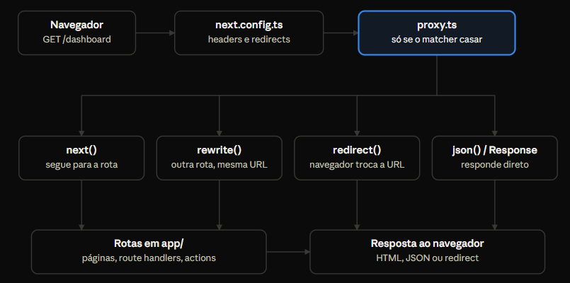

# Proxy no Next.js 16

O que é o proxy

O proxy é uma função que roda no servidor **antes** de uma requisição chegar a uma rota, e pode reescrever, redirecionar, alterar headers ou responder diretamente. No Next.js 16 ele substitui o antigo middleware.ts: mesmo conceito, novo nome de arquivo ``proxy.ts`` e nova função exportada ``proxy``.

Pense nele como um porteiro: olha quem chega, pode mandar para outra porta, carimbar o crachá ou barrar a entrada, mas não faz o trabalho de quem está dentro do prédio.

A cada requisição que casa com o matcher, o Next.js executa o proxy depois das regras de ``headers`` e ``redirects`` do ``next.config.ts`` e antes de resolver qualquer rota do ``app/``. O proxy então escolhe uma de quatro saídas.



- **Onde fica**: ``proxy.ts`` na raiz do projeto ou em ``src/``, no mesmo nível de app/. Neste repositório: ``apps/web/src/proxy.ts``.
- **Onde roda**: no servidor, no runtime Node.js. Nunca no navegador.
- **Quando roda**: em toda navegação, fetch de RSC, prefetch e chamada de Server Action cujo caminho case com o matcher.

## Anatomia de um proxy.ts

Um proxy tem duas partes: a função ``proxy``, que recebe a requisição e devolve uma resposta, e o ``config.matcher``, que define em quais caminhos ela roda. Existe um único ``proxy.ts`` por app, na raiz do projeto ou em ``src/`` (no mesmo nível de ``app/``).

```
    // apps/web/src/proxy.ts
    import { type NextRequest, NextResponse } from "next/server";

    export function proxy(request: NextRequest) {
        // 1. Ler a requisição
        const { pathname } = request.nextUrl;

        // 2. Decidir o que fazer
        if (pathname === "/antigo") {
            return NextResponse.redirect(new URL("/novo", request.url));
        }

        // 3. Seguir para a rota normalmente
        return NextResponse.next();
    }

    export const config = {
        matcher: ["/antigo", "/dashboard/:path*"],
    };
```

| Faça | Evite | Por quê |
| --- | --- | --- |
| Use `matcher` restrito | Rodar em tudo, inclusive `_next/static` | Custo e latência em cada asset |
| Checagens leves (cookie, header, path) | Consultas a banco ou APIs lentas | Bloqueia a resposta de toda página |
| Autorização real na DAL e nas Server Actions | Confiar só no proxy para segurança | Um `matcher` mal escrito deixa rotas expostas |
| `redirects()` / `rewrites()` no `next.config.ts` para regras fixas | Reimplementar regras estáticas no proxy | Config declarativa é mais simples e barata |
| Headers pequenos e poucos | Copiar objetos grandes para headers | Pode gerar erro 431 (headers grandes demais) |
| `NextResponse.next()` como saída padrão | Esquecer o `return` em algum caminho | Comportamento imprevisível |

Sobre o ``matcher``:
- Aceita strings com parâmetros ``/blog/:slug``, curingas ``:path*`` e regex.
- Os valores precisam ser constantes estáticas: são lidos em build, então variáveis ou funções não funcionam.
- Aceita objetos com ``source``, ``has`` e ``missing`` para filtrar por header, cookie ou query.
- Sem ``matcher``, o proxy roda em todas as requisições, inclusive assets — quase nunca é o que você quer.

## Exemplo prático: headers de segurança e logging

O proxy de ``apps/web/src/proxy.ts`` faz três coisas em toda página: registra a requisição, gera um ID de rastreio e adiciona headers de segurança na resposta.

```
    import { type NextRequest, NextResponse } from "next/server";

    export function proxy(request: NextRequest) {
        // biome-ignore lint/suspicious/noConsole: logging intencional para demonstração
        console.log(`[Proxy] ${request.method} ${request.nextUrl.pathname}`);

        // Headers extras que a rota vai receber (ida)
        const requestHeaders = new Headers(request.headers);
        requestHeaders.set("x-request-id", crypto.randomUUID());
        requestHeaders.set("x-pathname", request.nextUrl.pathname);

        const response = NextResponse.next({
            request: { headers: requestHeaders },
        });

        // Headers que o navegador vai receber (volta)
        response.headers.set("X-Frame-Options", "DENY");
        response.headers.set("X-Content-Type-Options", "nosniff");
        response.headers.set("X-Request-Id", requestHeaders.get("x-request-id") || "");

        return response;
    }

    export const config = {
        matcher: [
            // Tudo, exceto arquivos estáticos, otimização de imagens e favicon
            "/((?!_next/static|_next/image|favicon.ico).*)",
        ],
    };
```

- Headers da requisição ``NextResponse.next({ request: { headers } })`` seguem para a rota. Um Server Component pode lê-los com ``headers()`` de ``next/headers``.
- Headers da resposta ``response.headers.set`` voltam para o navegador e aparecem no DevTools.

O ``x-request-id`` aparece nos dois lados: a rota pode usá-lo em logs e o mesmo valor chega ao cliente, o que permite ligar um erro no navegador a uma linha de log no servidor.

Lendo o header dentro de uma página:

```
    // app/page.tsx (Server Component)
    import { headers } from "next/headers";

    export default async function Page() {
        const requestId = (await headers()).get("x-request-id");
        return <p>Request ID: {requestId}</p>;
    }
```

Para testar: rode ``pnpm dev --filter @repo/web``, abra **http://localhost:3000**, veja a linha ``[Proxy] GET`` / no terminal e confira ``X-Frame-Options`` e ``X-Request-Id`` na aba Network.

## Boas práticas e armadilhas

O proxy roda em praticamente toda requisição, então cada milissegundo e cada decisão errada ali se multiplicam.

| Faça | Evite | Por quê |
| --- | --- | --- |
| Use `matcher` restrito | Rodar em tudo, inclusive `_next/static` | Custo e latência em cada asset |
| Checagens leves (cookie, header, path) | Consultas a banco ou APIs lentas | Bloqueia a resposta de toda página |
| Autorização real na DAL e nas Server Actions | Confiar só no proxy para segurança | Um `matcher` mal escrito deixa rotas expostas |
| `redirects()` / `rewrites()` no `next.config.ts` para regras fixas | Reimplementar regras estáticas no proxy | Config declarativa é mais simples e barata |
| Headers pequenos e poucos | Copiar objetos grandes para headers | Pode gerar erro 431 (headers grandes demais) |
| `NextResponse.next()` como saída padrão | Esquecer o `return` em algum caminho | Comportamento imprevisível |

[Documentação oficial: Next.js — proxy](https://nextjs.org/docs/app/getting-started/proxy)